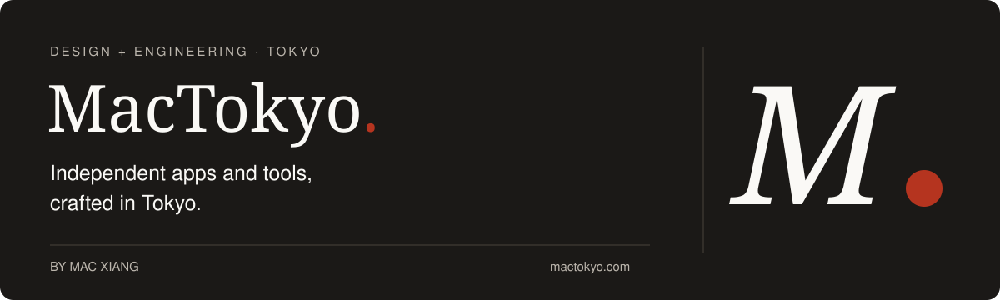
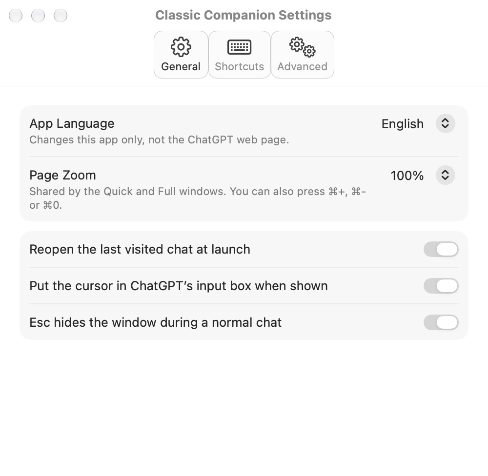

**Independent apps and tools, crafted in Tokyo.**

MacTokyo is the home of independent products by [Mac Xiang](https://github.com/xtymac), a product designer and engineer in Tokyo. From the first interaction to the finished app, design and engineering happen together, with attention to the details that make everyday tools easier to use.

[Website](https://mactokyo.com/) · [Contact](https://mactokyo.com/contact/)

## Featured app

### [Classic Companion](https://github.com/xtymac/ClassicCompanion)

**ChatGPT, a shortcut away on your Mac.**

A native macOS companion for the official ChatGPT website, designed to keep a conversation close while you work. Ask a quick question in a compact window, then switch to the full window when you need more room.

- **One shortcut away.** Press **⌥ Space** to bring up your chat. Customize the shortcuts for opening the app and switching window modes.
- **A familiar experience.** Sign in to ChatGPT and use its official web interface, with persistent sign-in and native settings for page zoom and app preferences.
- **Four interface languages.** Use the app in English, 日本語, 简体中文, or 繁體中文.

**[Try the beta →](https://github.com/xtymac/ClassicCompanion/releases)**

Public beta · macOS 15+ · Apple silicon. See the release notes for tested systems and known issues.

Take a look — native app settings

 

Classic Companion is an independent app, not affiliated with OpenAI. Source code (Apache-2.0), downloads and feedback are available together in the project repository.

## Design & engineering

MacTokyo brings together UX/UI, frontend engineering, and AI product design. Each project is an opportunity to shape both how a tool feels and how it works, from early interaction ideas to a usable app.
